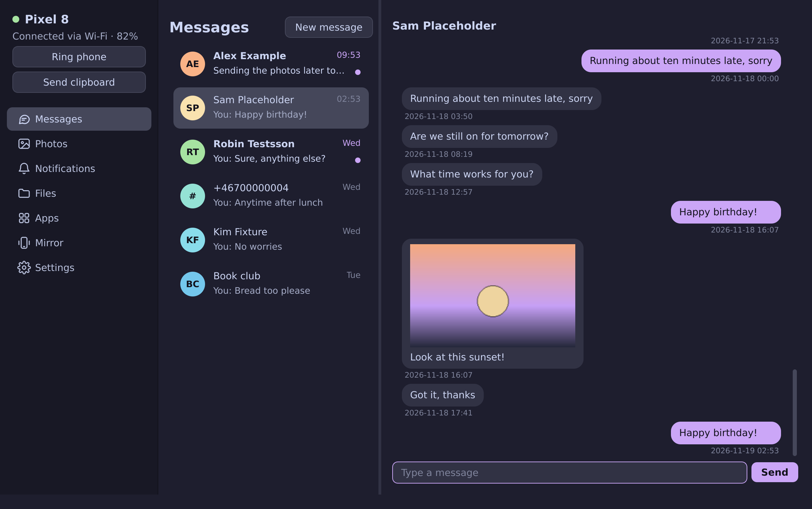
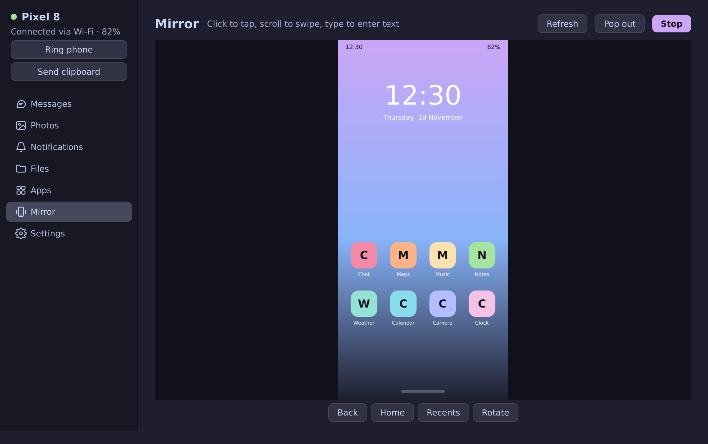
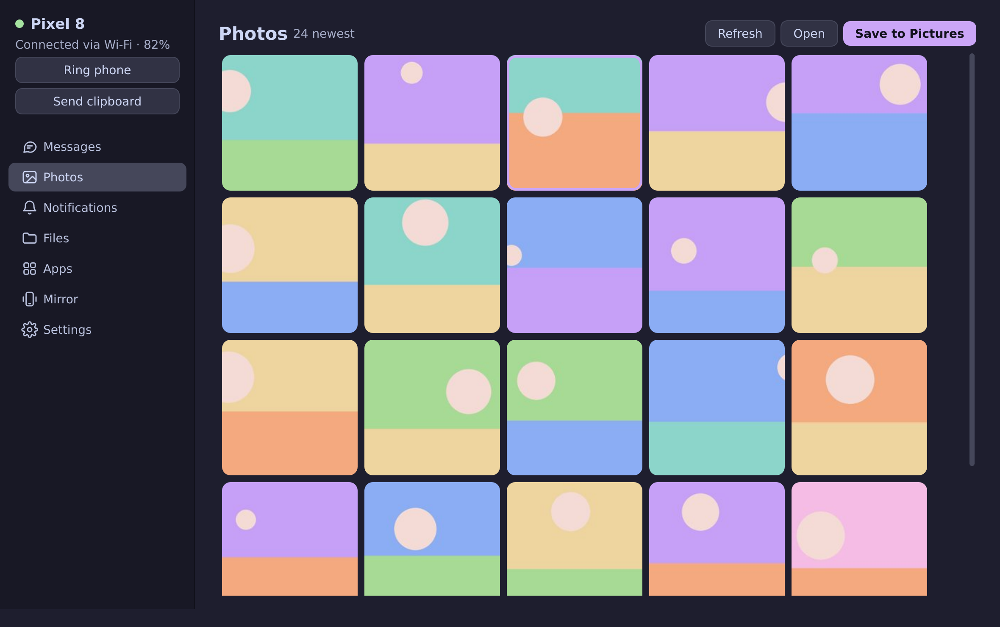
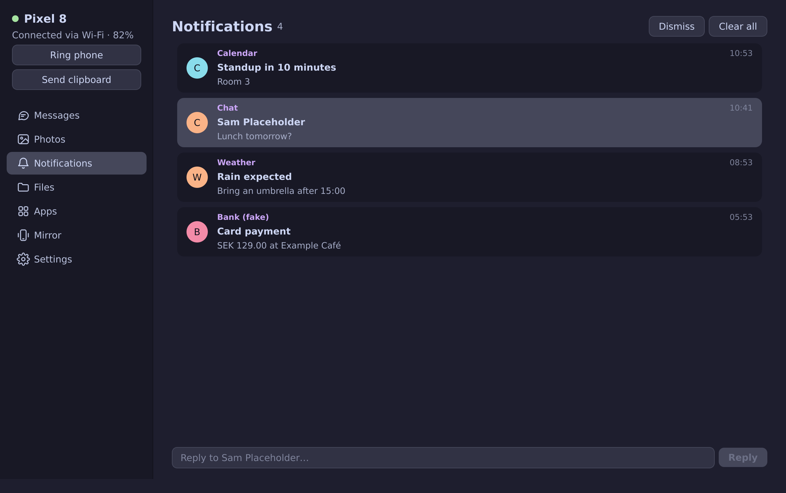
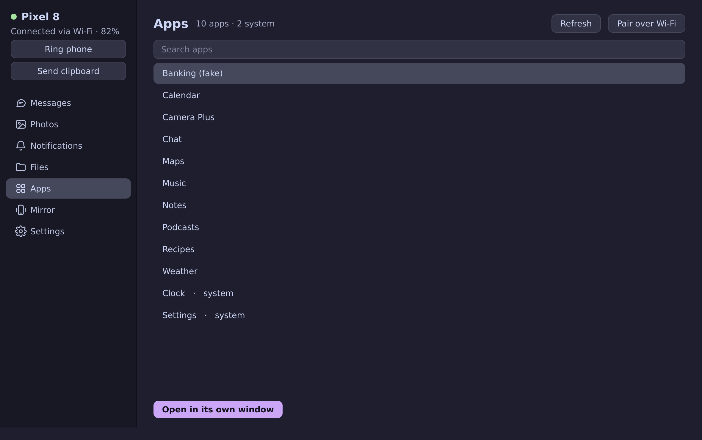
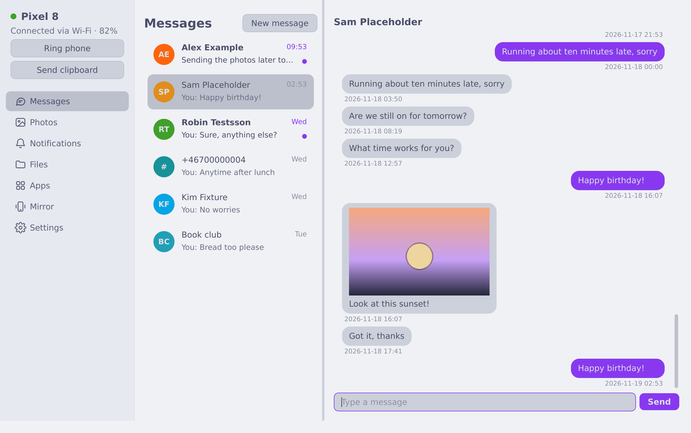

# Mooring

[](https://github.com/ms4ndst/mooring/actions/workflows/ci.yml)

A Phone Link–style hub for Linux: messages, notifications, photos, files, clipboard and
screen mirroring for an Android phone, in one window. Built with PyQt6 and themed with
Catppuccin. Developed on Fedora + Niri (Wayland).

Mooring is a front end. The phone protocol is handled by `kdeconnectd` (reached over D-Bus),
and mirroring by `scrcpy`. See [PLAN.md](PLAN.md) for the architecture and phases.

## Screenshots

All screenshots use synthetic data (`scripts/screenshots.py` renders them from the fake
backend), so no real messages, contacts, photos or phone screens appear.

| Messages | Mirror |
|---|---|
|  |  |
| **Photos** | **Notifications** |
|  |  |
| **Apps** | **Latte (light) theme** |
|  |  |

## Status

- Phase 1 skeleton, Phase 2 device & connection: done.
- Phase 3 messages: conversation list with contact names (from KDE Connect's contact
  sync), threads with lazy loading, reply, new message to a number, MMS pictures
  (thumbnails, click to open), desktop notifications with Open/Reply (inline reply on
  daemons that support it, e.g. Plasma or swaync; dunst opens the thread instead).
- Phase 4 photos, files, clipboard: photo grid with cached thumbnails, Save to Pictures,
  drag out; drop files on the window to send them; clipboard push and sync toggle.
- Phase 5 mirroring & apps: mirror the screen or open one phone app in its own window
  (scrcpy 3.0+, Niri opens each as a column); USB or Wi-Fi (wireless debugging) pairing.

Mirroring needs developer options on the phone: USB debugging (or Wireless debugging)
and `sudo dnf install android-tools scrcpy`.

Phone-side requirements: SMS and Contacts permissions for the KDE Connect app, and
its battery usage set to "Unrestricted", or Android delays SMS sync in the background.

## Install (Fedora)

Build and install the RPM (it pulls in KDE Connect, sshfs, adb and scrcpy):

```bash
./scripts/build-rpm.sh
sudo dnf install build/rpm/RPMS/noarch/mooring-*.noarch.rpm
```

The **Mirror** page shows the phone inside Mooring and decodes the video with PyAV, which
isn't packaged for Fedora. Install it for your user to enable it:

```bash
pip install --user av
```

Without it, the Mirror page offers **Pop out** (a separate scrcpy window).

Then: open KDE Connect on the phone and pair, grant it SMS/Contacts permissions and set
its battery use to "Unrestricted". For mirroring and phone apps, turn on USB (or
Wireless) debugging in the phone's developer options. Settings → "Start Mooring when I
log in" starts it in the tray.

**Phone on another Wi-Fi?** Plug it in with USB debugging on. Mooring then runs KDE
Connect through the cable (it shows "via USB cable"). Messages, notifications and the
clipboard work that way. Photos and files still need the phone on the same Wi-Fi.

**Two popups for every SMS?** Mooring posts its own popup for new messages (Open/Reply
jump to the conversation), and KDE Connect also forwards the phone's SMS-app
notification. To keep only Mooring's: in the KDE Connect app on the phone, open the
laptop's device page → Plugin settings → Notification sync, and untick your SMS app.

## Run from a checkout

```bash
python3 -m venv .venv
.venv/bin/pip install -e ".[dev]"          # dev extra includes PyAV
.venv/bin/mooring --install-desktop-entry  # launcher + icon in ~/.local/share
.venv/bin/mooring                          # or: --fake for synthetic data, --hidden for tray
```

PyQt6 6.12 ships broken type stubs, so the `dev` extra pins 6.11 so mypy stays usable.
The runtime itself works with either version.

Niri has no built-in tray or notification daemon: the tray icon shows up in Waybar (its
StatusNotifierItem module), notifications need mako/dunst/swaync. Without a tray, closing
the window quits the app.

## Develop

```bash
.venv/bin/pytest            # headless (QT_QPA_PLATFORM=offscreen)
.venv/bin/ruff check src tests && .venv/bin/ruff format src tests
.venv/bin/mypy
QT_QPA_PLATFORM=offscreen .venv/bin/python scripts/screenshots.py   # refresh docs/screenshots
```

## Privacy

Mooring handles your SMS, contacts and photos, and other people's. Never log message bodies,
phone numbers or contact names, only IDs and counts. Test fixtures use synthetic data only.
